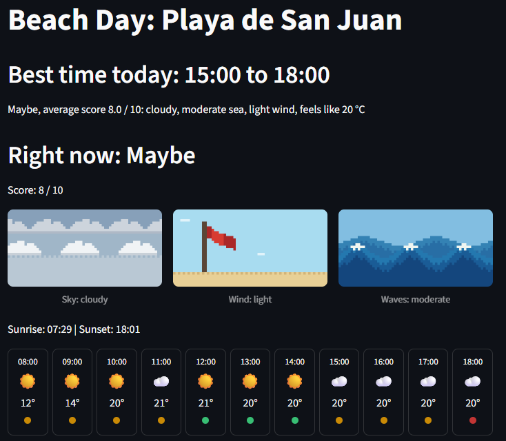
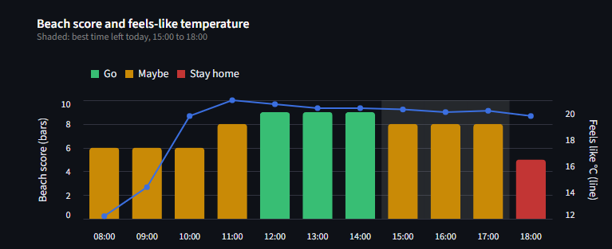

# Beach Day: Playa de San Juan

**Is today a good beach day?** A Streamlit web app that scores beach conditions
hour by hour at Playa de San Juan (Alicante, Spain) from live weather and sea
forecasts, and tells you the best time to go.

**Live app:** https://beach-day-san-juan.streamlit.app/

*Hosted on Streamlit's free tier: if the app has been asleep, click "wake up"
and it'll be ready in under a minute.*





## What it shows

- **Best time today:** the longest run of good hours still to come, with a
  short reason (e.g. "cloudy, moderate sea, light wind, feels like 20 °C").
- **Right now:** the current hour's verdict and score.
- **Sky, wind and waves** as original 16-bit pixel-art animations, generated
  in Python with Pillow.
- **An hourly strip** for daylight hours: sky, feels-like temperature and a
  coloured verdict dot.
- **A chart** of the beach score per hour (bars coloured Go / Maybe / Stay
  home) with the feels-like temperature, and the best window shaded.
- **All the data** in a collapsible table for anyone who wants the details.

## Why I built this

Playa de San Juan is my favourite beach, and before going I always ended up
checking several weather and sea forecasts to decide if it was worth it that
day. I built this app to answer that question in one place: is it a good beach
day, and when is the best time to go?

## How the beach score works

Each hour is rated in three steps:

1. **Night:** hours outside sunrise–sunset get the verdict "Night" and no score.
2. **Deal breakers:** any of these forces "Stay home", whatever the score:
   rain chance of 50% or more, wind over 30 km/h, gusts over 50 km/h, or a
   rough sea (waves over 1 m).
3. **Points:** otherwise the hour earns points out of 10:

| Rule | Condition | Points |
| --- | --- | --- |
| Feels-like temperature | 20–32 °C | 3 |
| Rain chance | under 20% | 2 |
| Wind | under 20 km/h | 1 |
| Gusts | under 35 km/h | 1 |
| Cloud | under 50% | 1 |
| Waves | calm (under 0.5 m) / moderate (0.5–1 m) | 2 / 1 |

**Verdict:** Go (9–10), Maybe (6–8), Stay home (0–5).

All limits are named constants at the top of `scoring.py`. The sky, wind and
wave pictures use the same constants, so they always agree with the score.

## Data and limitations

- Weather and sea forecasts come from [Open-Meteo](https://open-meteo.com/)
  (free, no API key).
- **The sea data comes from about 10 km offshore.** Open-Meteo's marine grid
  has no point closer to the beach on this side of Cabo de las Huertas, so the
  waves describe open water; conditions at the shoreline may be calmer.
- The verdict is a forecast-based estimate, **not the official lifeguard
  flag**. Always follow the flags and lifeguards on the beach.

## Run it locally

```
python -m pip install -r requirements.txt
python -m streamlit run app.py
```

Run the tests:

```
python -m pytest
```

Regenerate the pixel-art GIFs (only needed if you change their design):

```
python make_gifs.py
```

## Project structure

| File | What it does |
| --- | --- |
| `fetch.py` | Requests to Open-Meteo, with warnings for missing values |
| `combine.py` | Joins weather and sea data into one hourly table and rates each hour |
| `scoring.py` | All the beach logic: thresholds, score, verdict, deal breakers, categories, best window |
| `charts.py` | Chart-building functions (Altair) |
| `app.py` | The Streamlit page: display only, no logic |
| `make_gifs.py` | Draws the pixel-art GIFs in `assets/` |
| `test_scoring.py` | Tests for the scoring logic |
| `test_fetch.py` | Tests for the retry logic when Open-Meteo has a temporary error |

## How I built this

I built this app with [Claude Code](https://www.anthropic.com/claude-code), an
AI coding agent, working in small steps rather than asking for the whole app
at once. The instructions and rules I gave it are in [CLAUDE.md](CLAUDE.md).

How I worked:

- **One step at a time:** fetch the weather, then the sea data, then combine
  them, then the score, then the page. I checked each step myself (for
  example, comparing values with the raw API response) before committing.
- **I made the design decisions:** what counts as a good beach day, the deal
  breakers, ignoring night hours, and how the app should look.
- **Testing:** 105 tests cover the scoring logic (values right on each limit
  and missing data) and the retry logic for temporary API errors. The tests were also checked by deliberately breaking each
  rule and confirming a test failed (mutation testing).
- **Data quality:** the app warns about missing values and lost rows, and the
  offshore limitation of the sea data is documented above.
- **Reliability:** API responses are cached for an hour, temporary errors are
  retried, and if the forecast service is down the page shows a friendly
  message instead of crashing.

## Credits

Weather and marine data by [Open-Meteo.com](https://open-meteo.com/), used
under [CC BY 4.0](https://creativecommons.org/licenses/by/4.0/).
